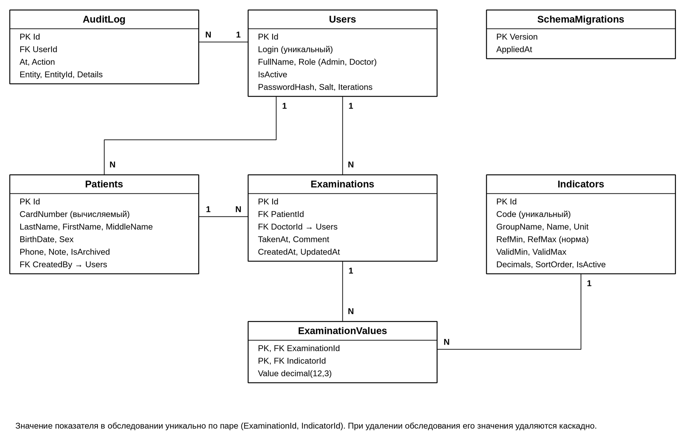
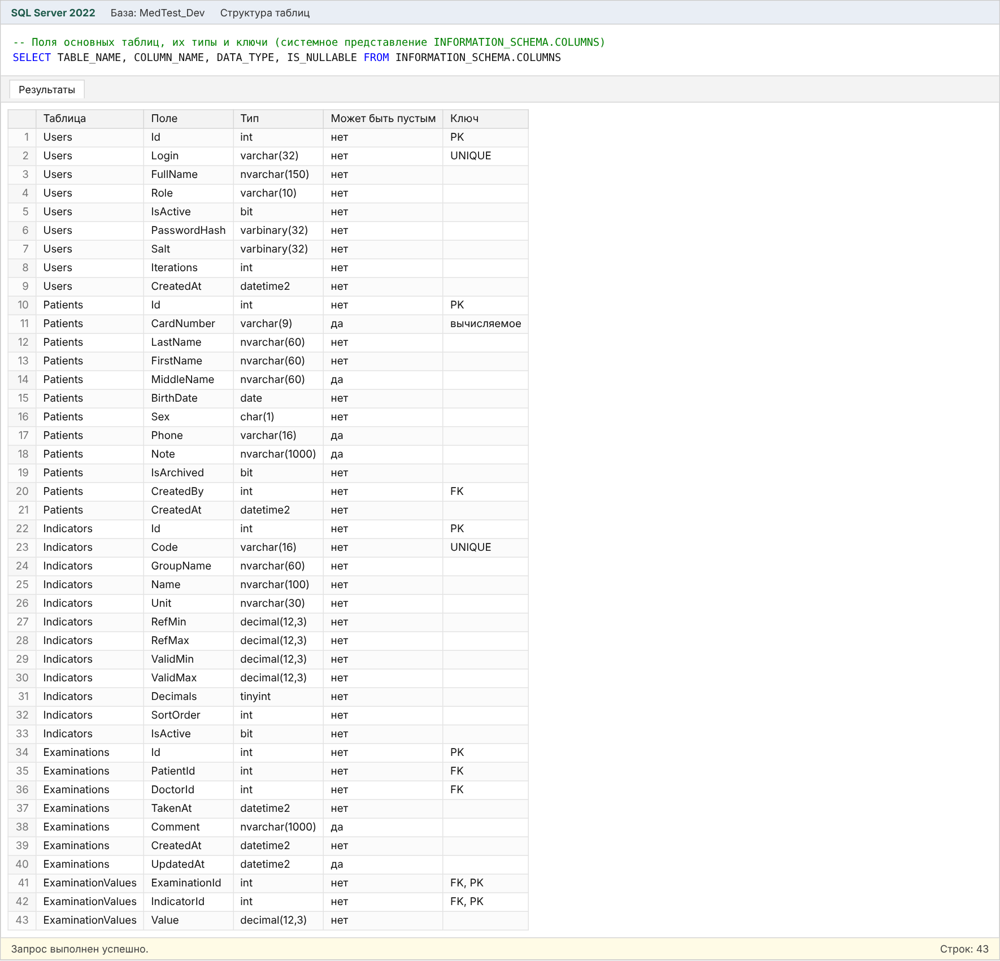
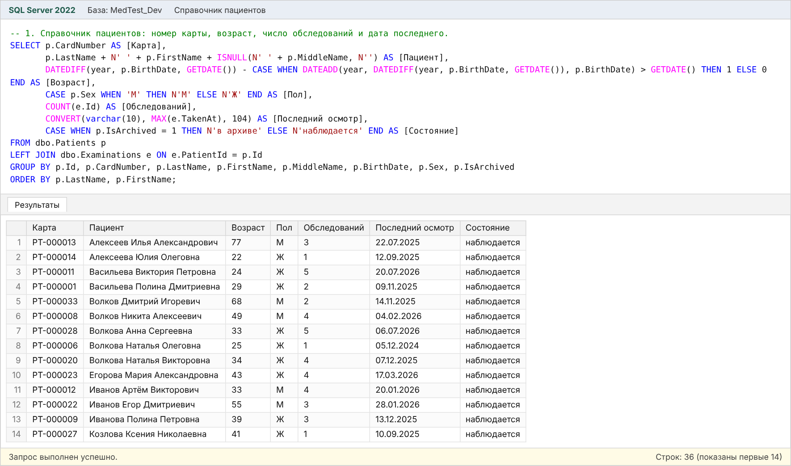
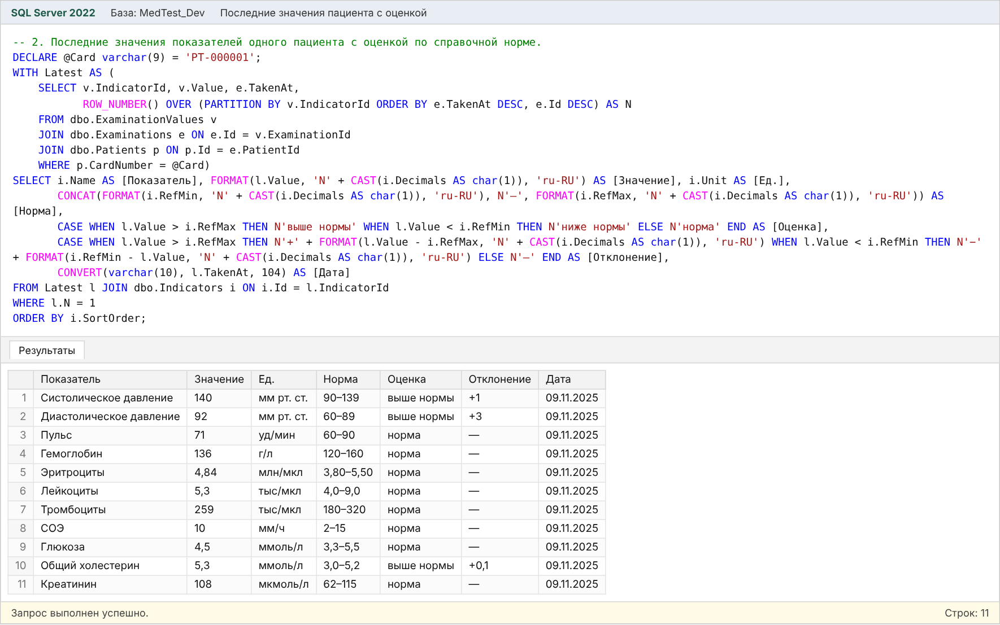
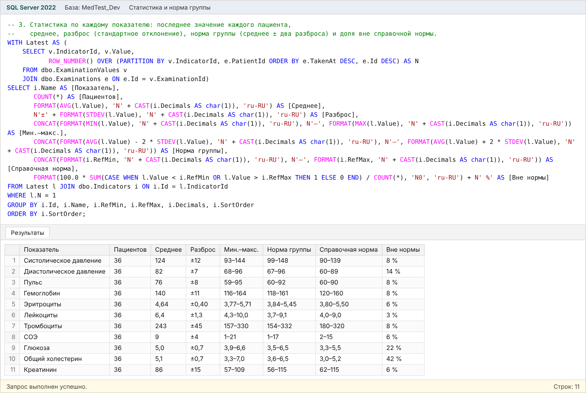
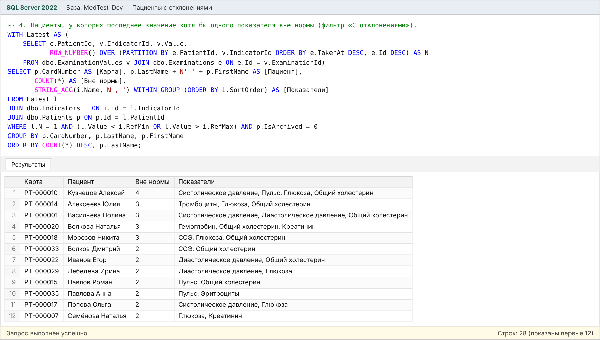
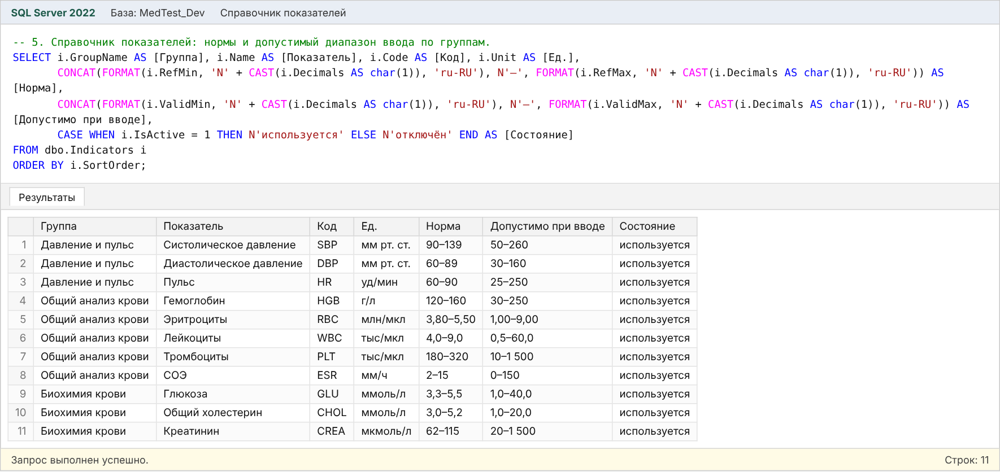
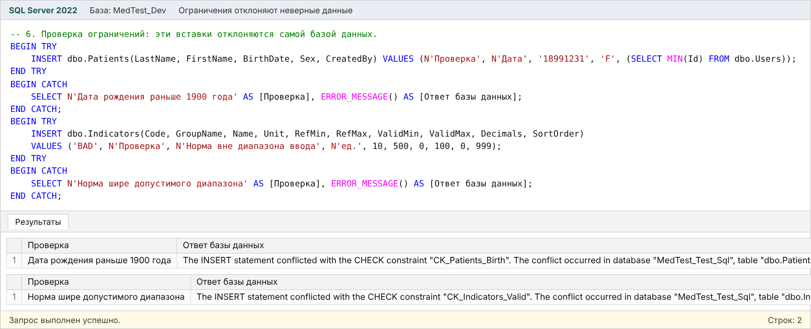
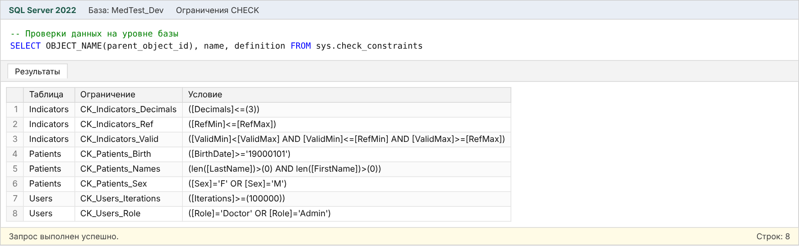

# Модуль 1. База данных и слой доступа к данным

База данных системы «МедТест» на Microsoft SQL Server: пациенты, обследования, значения показателей, справочник показателей с нормами, сотрудники и история изменений. Слой доступа на ADO.NET проверяет права ролей и вводимые данные.

## Что в папке

| Папка | Содержимое |
|---|---|
| `SQL` | Скрипты создания базы, примеров данных и запросов |
| `Скриншоты` | ER-диаграмма, структура таблиц и результаты запросов |
| `Документация` | Описание модуля (Word) |
| `Исходный_код` | Модели и расчёты (`MedTest.Core`), слой данных (`MedTest.Data`), программа настройки (`MedTest.Setup`), тесты (`MedTest.Tests`) |

## SQL-скрипты

| Файл | Что делает |
|---|---|
| `01_создание_базы.sql` | Создаёт базу `MedTest_Dev`: 7 таблиц, ключи, ограничения CHECK, индексы, справочник из 11 показателей. Повторный запуск ничего не меняет |
| `02_примеры_данных.sql` | 36 пациентов, 108 обследований, 980 значений показателей. Паролей в скрипте нет |
| `03_запросы.sql` | 6 запросов: справочник пациентов, последние значения с оценкой, статистика и норма группы, пациенты с отклонениями, справочник показателей, проверка ограничений |
| `Создать_базу.cmd` | Выполняет 01 и 02 через `sqlcmd` на `(localdb)\MSSQLLocalDB` |

### Запуск

1. Установите SQL Server Express LocalDB и `sqlcmd` (ставятся с Visual Studio или SQL Server Management Studio).
2. Запустите `SQL/Создать_базу.cmd` — или откройте скрипты в SSMS, подключившись к `(localdb)\MSSQLLocalDB`, и выполните по порядку.
3. Выполните `03_запросы.sql`.

База, созданная скриптами, совместима с приложением (модули 2–4): учётные записи для входа создаёт `Первый_запуск.cmd`.

## Таблицы

| Таблица | Назначение |
|---|---|
| `Users` | Сотрудники: логин, ФИО, роль (Admin / Doctor), активность, хеш пароля PBKDF2-SHA256 с солью |
| `Patients` | Пациенты: номер карты `PT-000001` (вычисляемый столбец), ФИО, дата рождения, пол, телефон, примечание, архив |
| `Indicators` | Показатели: код, группа, название, единица, справочная норма, допустимый диапазон ввода |
| `Examinations` | Обследования: пациент, врач, дата и время, комментарий |
| `ExaminationValues` | Значения показателей обследования (ключ — обследование + показатель) |
| `AuditLog` | История изменений |
| `SchemaMigrations` | Применённые версии структуры |

## Скриншоты

### ER-диаграмма базы данных

### Структура таблиц: поля, типы, ключи

### Запрос 1: справочник пациентов с числом обследований

### Запрос 2: последние значения пациента с оценкой по норме

### Запрос 3: статистика и норма группы по каждому показателю

### Запрос 4: пациенты с отклонениями

### Запрос 5: справочник показателей

### Запрос 6: база сама отклоняет неверные данные

### Ограничения CHECK в базе данных

